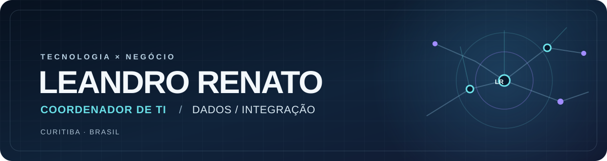

  

  <a href="https://www.linkedin.com/in/leandro-renato-/">LinkedIn</a>
  &nbsp;·&nbsp;
  <a href="https://github.com/Leandrorenatodossantos?tab=repositories">Repositórios</a>
  &nbsp;·&nbsp;
  Curitiba, PR

## Tecnologia que entende o negócio

Sou **Leandro Renato dos Santos**, **Coordenador de TI**, engenheiro de software e contador. Minha trajetória conecta processos, sistemas e dados para apoiar decisões e fazer a tecnologia funcionar melhor para as pessoas.

Atuei por **10 anos no setor de construção**, passando da contabilidade para BI e TI. Nos últimos **cerca de 5 anos**, trabalhei na interface entre inteligência de negócios e tecnologia, chegando à coordenação da área de TI.

<table>
  <tr>
    <td width="33%" valign="top"><strong>01 / Sistemas</strong>  Coordenação de equipes e demandas de sistemas, infraestrutura e integração.</td>
    <td width="33%" valign="top"><strong>02 / Dados</strong>  BI, indicadores e automação para transformar informação em decisões mais claras.</td>
    <td width="33%" valign="top"><strong>03 / Negócio</strong>  Visão contábil e de gestão para conectar prioridades técnicas aos objetivos da operação.</td>
  </tr>
</table>

### Contexto de atuação

`Gestão de TI` · `Integração de sistemas` · `BI e dados` · `ERP TOTVS` · `Automação` · `Governança`

### Código e estudos públicos

- **[Aplicativo de produção diária — TCC](https://github.com/Leandrorenatodossantos/tcc-app-flutter)** · Projeto acadêmico em Flutter/FlutterFlow.
- **[Sistema de xadrez em Java](https://github.com/Leandrorenatodossantos/chess-system-java)** · Estudo de programação em Java.

---

  <strong>Vamos conversar sobre tecnologia, dados e integração?</strong> 
  <a href="https://www.linkedin.com/in/leandro-renato-/">Conecte-se comigo no LinkedIn →</a>

